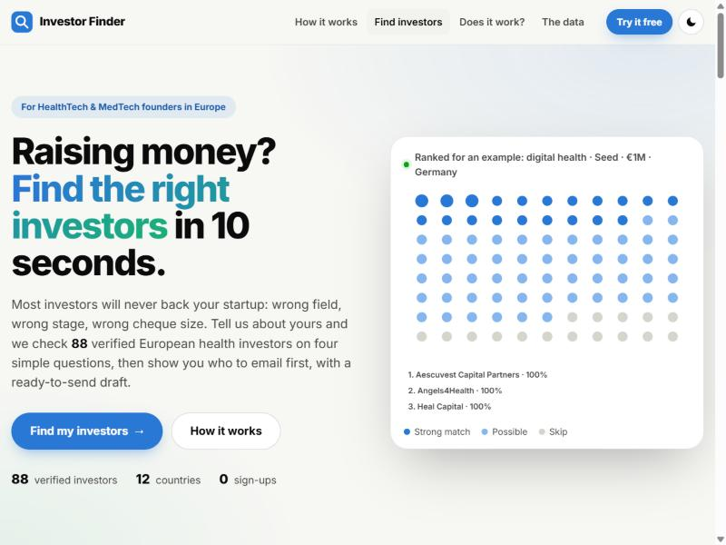
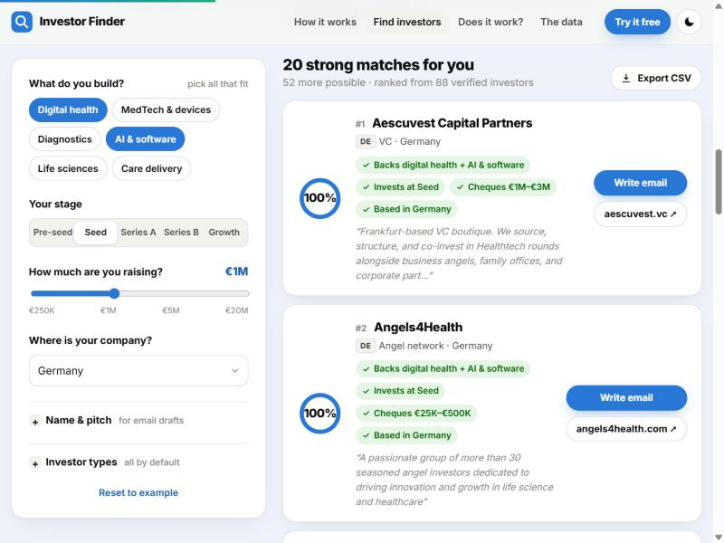

# 📊 Investor Intelligence Engine


**Live demo:** https://investor-intelligence-engine-omrana.netlify.app · static site, loads instantly, no sign-up



**Investor Finder** helps HealthTech and MedTech founders in Europe answer the first
fundraising question: *who should I email first?* Pick what you build, your stage, how much
you're raising and where you are; it ranks **88 verified European health investors** on four
plain questions and writes a ready-to-send email for each.

| | |
|---|---|
| **Field** (40%) | Do they back your area? Health specialists score higher than generalists. |
| **Stage** (25%) | Do they invest at your stage? Adjacent stage = half credit. |
| **Cheque** (20%) | Does their usual ticket fit inside your round? |
| **Location** (15%) | Local first, then Europe; regional-only funds are flagged. |



**What a founder can do with it**

- **Find:** ranked list with a match %, and a ✓ / – / ✗ reason for each of the four questions.
- **Write:** a ready email per investor, built only from the data; one click opens it in
  their email app. Optional **✦ Personalize with AI** rewrites it with Gemini.
- **Let AI fill the form:** paste a description or a website link and Gemini fills in
  field, stage, round size, country, name and pitch.
- **Track:** save investors to a pipeline board (To contact → Emailed → Replied → Meeting
  → Passed) with follow-up dates, overdue badges, notes and CSV export. Opening an email
  moves the investor to *Emailed* with a follow-up in 7 days.

AI features are bring-your-own-key: the visitor pastes a free Gemini key
(aistudio.google.com/apikey), which stays in their browser and is sent only to Google's
API. Without a key everything else works. The pipeline lives in the browser's local
storage; nothing is sent to a server.

### The investor data

`data/european_health_investors.csv` (also `site/investors.js`): 88 VC funds, angel networks,
family offices, corporate and public funds investing in European health startups, compiled
from hands-on research for a real seed raise.

- **Every website was opened and checked live** (23 Oct 2026); unreachable or unconfirmed
  firms were removed (96 → 88).
- **Firm-level public information only:** name, type, country, stages, typical ticket,
  focus, website, generic inbox (info@/office@…). No individuals, no personal emails.
- Public mandates are recorded (e.g. "companies with a Berlin presence") so the finder
  can flag funds a founder can't actually raise from.

### Behind it: an evaluated scoring method

The four-question rubric was first built and evaluated offline on a 520-profile practice
universe with a simulated expert shortlist. That pipeline (Python, below) is what the
evaluation numbers come from; the live finder uses the same four questions and the
hand-set weights, which held out within one point of the tuned ones.

## Results

| | Value |
|---|---|
| Investors screened | 520 (synthetic universe, fictional names) |
| **Held-out precision** (tuned on half A, scored on unseen half B, 25 splits) | **68% ± 6%** |
| Analyst noise ceiling (same analyst re-run with fresh noise) | 69% (range 60–78%) |
| In-sample precision@40 (v2 rubric) | 72.5% (95% CI 57–84%) |
| ROC-AUC, analyst picks vs non-picks | 0.96 |
| Recall@80 | 85% |

What the evaluation showed:

- **In-sample tuning overstated the gain.** A 3,024-config sweep looks like 65% → 75%
  when you tune and score on the same shortlist. On held-out halves the tuned rubric
  reaches 68%, against 67% for the hand-set v1 weights: about one point, with an
  8-point optimism gap.
- **One change was real.** Counting clinical-operations language (hospital pilots,
  MDR, reimbursement) toward thesis fit was chosen in 25 of 25 splits. The weight
  shifts were mostly noise.
- **The model is at the noise ceiling.** The analyst agrees with their own re-run only
  69% of the time, so pushing past ~70% would mean fitting gut feel, not signal.
- **Ties matter.** Four investors share the score at the top-40 cutoff, so precision@40
  can land anywhere from 72.5% to 75% depending on tie-breaking. Ranking is now stable
  and deterministic.

## Pipeline

```
investors.csv (520) ──▶ scoring (rubric | LLM) ──▶ ranked pipeline
                                                        │
analyst shortlist (40, simulated) ──▶ evaluation ◀──────┘
                                       • precision / recall / AUC
                                       • held-out splits + noise ceiling
                                       • LLM vs rubric on the same investors
                                                        │
                                   outreach drafts ◀────┘──▶ static dashboard (site/)
```

1. **Dataset:** 520 investor profiles with thesis, stage focus, ticket size, geography
   and portfolio. Synthetic, shaped like a real DACH MedTech seed screen.
2. **Simulated analyst shortlist:** 40 picks from a heuristic screen plus random
   "gut-feel" noise. The real fundraise pipeline is client-confidential and lives on
   a different universe, so the ground truth is simulated, and its noise is measurable.
3. **Scoring:** 0–100 on a 4-dimension weighted rubric: thesis 45%, stage 25%,
   ticket 20%, geography 10%. Offline rubric by default; `--mode llm` asks Gemini
   (free tier) or Claude for the same four scores in strict JSON.
4. **Evaluation:** precision@40 with a Wilson interval, recall@80, ROC-AUC, then
   held-out tuning over 25 stratified splits and a noise ceiling from 50 analyst re-runs.
5. **LLM vs rubric:** a stratified sample (30 analyst picks + 30 others) scored both
   ways; Spearman agreement per dimension, AUC of each scorer, biggest disagreements.
6. **Outreach:** a personalized draft per top investor, with an automatic check that
   each draft cites a portfolio company it was actually given.
7. **Site:** the evaluation summary is exported to `site/proof.js` for the Investor Finder.

## Quickstart

```bash
pip install -r requirements.txt
python run_all.py            # whole offline pipeline, no API key, ~10 s
```

Then open `site/index.html` in a browser for the Investor Finder, or explore the
evaluation pipeline locally with `streamlit run app.py`.

### LLM mode (free)

Get a free Gemini key at https://aistudio.google.com/apikey, then:

```bash
set GEMINI_API_KEY=your-key                     # macOS/Linux: export GEMINI_API_KEY=...
python src/scoring.py --mode llm --sample 60    # 30 analyst picks + 30 others
python src/compare.py                           # LLM vs rubric
python run_all.py                               # refresh reports + dashboard
```

On Windows, `RUN-LLM.bat` does the same with prompts.

- Every response is cached in `output/llm_cache.jsonl`. If the free tier's daily quota
  runs out, the run stops cleanly; the same command the next day resumes where it stopped.
- LLM results go to `output/scored_investors_llm.csv`, never over the rubric pipeline.
  Each row records `score_source = llm | rubric_fallback`, so a failed call can't pass
  silently as an LLM score.
- A bad key or retired model aborts at once with a clear message. Override the model
  with `--model` or `GEMINI_MODEL`; `--provider claude` uses `ANTHROPIC_API_KEY`.

### Tests

```bash
pip install -r requirements-dev.txt
pytest -q
```

CI (`.github/workflows/ci.yml`) runs the tests and the full offline pipeline on every push.

## Deploy the Investor Finder

`site/` is plain HTML/CSS/JS (data in `site/investors.js` and `site/proof.js`), so any
static host works and it never "sleeps" the way a free Streamlit Cloud app does:

- **Netlify:** drag the `site` folder onto https://app.netlify.com/drop.
- **GitHub Pages:** Settings → Pages → deploy from branch, folder `/site`.

Scoring, filtering, CSV export and email drafts all run in the visitor's browser;
nothing is sent to a server.

## Key learnings

- **A number measured on the data you tuned on is a claim, not a result.** Held-out
  splits turned an apparent 10-point gain into one point.
- **Know your ceiling.** Measuring how often the analyst agrees with themselves showed
  where more tuning stops helping.
- **LLMs need rubrics, not vibes.** Four defined dimensions, anchors and strict JSON make
  scores comparable across 500 calls and across providers.
- **Fail loudly.** The first LLM attempt silently fell back to the rubric on every row
  and overwrote the full pipeline. Now every row is labelled with its source, partial
  runs write to their own file, and fatal errors stop the run.
- **Automate the screen, keep the judgment.** The pipeline ranks and drafts; the
  shortlist call and every sent email stay human.

## Project structure

```
├── run_all.py               # one command: whole offline pipeline
├── app.py                   # Streamlit dashboard (local)
├── site/                    # Investor Finder (deploy this)
├── data/
│   ├── european_health_investors.csv  # 88 verified real investors
│   ├── investors.csv        # 520-profile practice universe (synthetic)
│   ├── manual_shortlist.csv # simulated analyst shortlist (40)
│   └── startup_profile.json # the anonymized startup being matched
├── src/
│   ├── generate_dataset.py
│   ├── make_shortlist.py    # simulated analyst (heuristic + noise)
│   ├── scoring.py           # rubric + LLM scoring engine
│   ├── llm.py               # Gemini/Claude client: cache, pacing, typed errors
│   ├── evaluate.py          # precision@40, recall@80, AUC
│   ├── tune_rubric.py       # held-out tuning + noise ceiling
│   ├── compare.py           # LLM vs rubric
│   ├── outreach.py          # grounded email drafts
│   ├── metrics.py
│   └── export_site.py       # evaluation summary -> site/proof.js
├── tests/
└── output/                  # scored pipeline, reports, drafts
```

---
*Built by Om Rana, NIT Rourkela '25. Based on investor-screening work for a live
European MedTech fundraise (client details anonymized; all data here is synthetic).*
